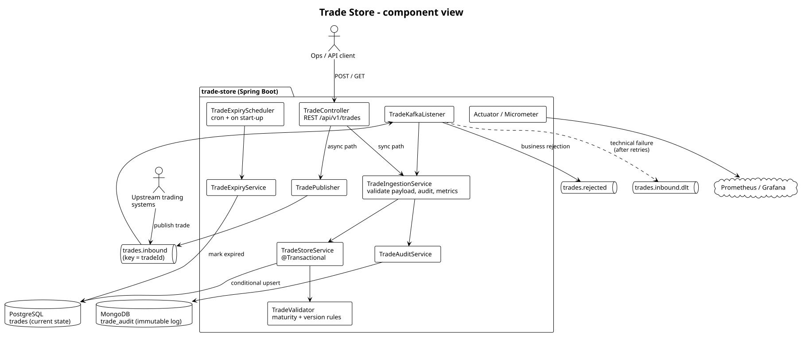
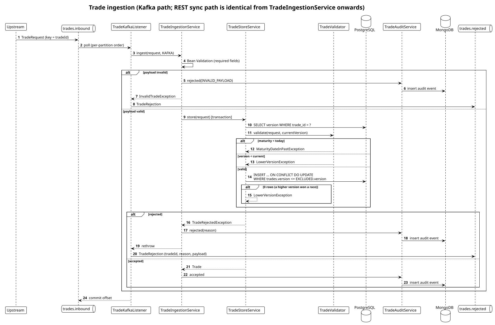
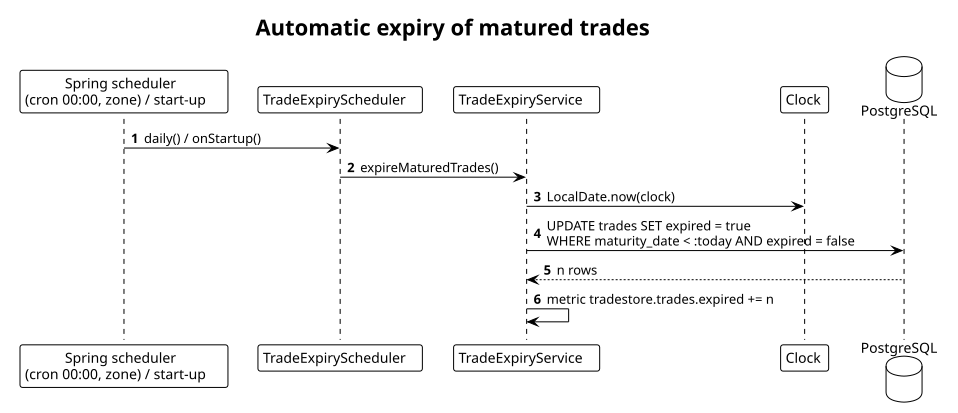
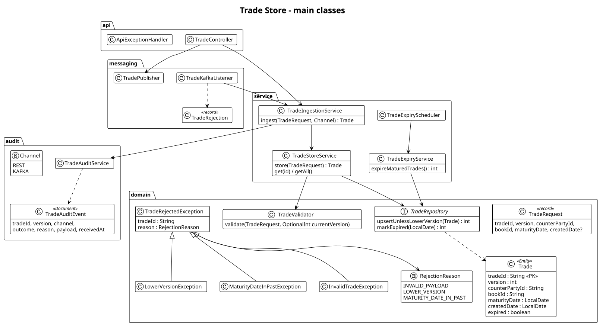
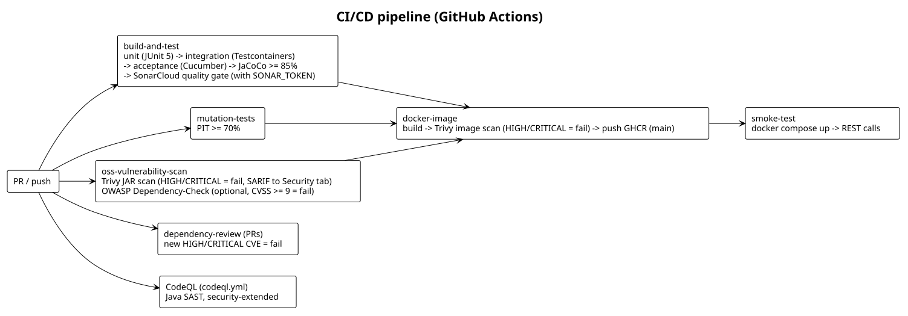

# Trade Store

A trade store that receives thousands of trades over any transmission channel, keeps the latest version of each
trade in sequence, and applies the rules from the brief:

1. A **lower version** is rejected with an exception; the **same version replaces** the stored record.
2. A trade whose **maturity date is before today** is rejected.
3. Stored trades are **automatically marked expired** once their maturity date passes.

**Stack:** Java 17, Spring Boot 3.5, Apache Kafka (streaming), PostgreSQL (SQL, current state), MongoDB (NoSQL,
audit log), Flyway, Micrometer/Prometheus, JUnit 5 + Testcontainers + Cucumber, GitHub Actions.

| Document | Contents |
|---|---|
| [docs/ASSUMPTIONS.md](docs/ASSUMPTIONS.md) | How the brief (including the contradictory T3 row) was interpreted, rule by rule |
| [docs/NFR.md](docs/NFR.md) | Non-functional requirements, targets and how each is met |
| [docs/TEST-STRATEGY.md](docs/TEST-STRATEGY.md) | Test pyramid, TDD approach, what runs where |
| [docs/adr/](docs/adr) | Architecture decision records |
| [AI_PROMPTS.md](AI_PROMPTS.md) | AI usage disclosure and all prompts, as the brief requests |

## Architecture



- Every channel goes through one `TradeIngestionService`: payload validation → business rules → store → audit → metrics.
- Kafka messages are keyed by `tradeId`, so versions of one trade are processed in order; different trades in parallel.
- The version rule is enforced **atomically in the database** (`INSERT … ON CONFLICT … WHERE trades.version <= EXCLUDED.version`),
  so a lower version can never overwrite a higher one even under concurrent delivery ([ADR-0003](docs/adr/0003-atomic-conditional-upsert.md)).
- Business rejections go to `trades.rejected` (and HTTP 422); technical failures are retried, then parked on `trades.inbound.dlt`.
- Every received message, accepted or rejected, is written to the MongoDB audit log.

| Diagram | |
|---|---|
| Ingestion sequence |  |
| Expiry sequence |  |
| Class diagram |  |
| CI/CD pipeline |  |

PlantUML sources are in [docs/diagrams](docs/diagrams) (`java -jar plantuml.jar -tsvg docs/diagrams/*.puml`).

## Run it

```bash
docker compose up -d --build          # Kafka, PostgreSQL, MongoDB and the app on :8080
```

Or open the repository in **GitHub Codespaces** (Dev Container included) and run the same command.
Swagger UI: http://localhost:8080/swagger-ui.html · Metrics: http://localhost:8080/actuator/prometheus

```bash
# Store a trade (synchronous, returns the stored trade or the rejection reason)
curl -X POST localhost:8080/api/v1/trades -H 'Content-Type: application/json' \
  -d '{"tradeId":"T2","version":2,"counterPartyId":"CP-2","bookId":"B1","maturityDate":"20/05/2030"}'

# Lower version -> 422 {"reason":"LOWER_VERSION", ...}
curl -X POST localhost:8080/api/v1/trades -H 'Content-Type: application/json' \
  -d '{"tradeId":"T2","version":1,"counterPartyId":"CP-1","bookId":"B1","maturityDate":"20/05/2030"}'

# Past maturity -> 422 {"reason":"MATURITY_DATE_IN_PAST", ...}
curl -X POST localhost:8080/api/v1/trades -H 'Content-Type: application/json' \
  -d '{"tradeId":"T3","version":3,"counterPartyId":"CP-3","bookId":"B2","maturityDate":"20/05/2014"}'

# Asynchronous via Kafka -> 202
curl -X POST localhost:8080/api/v1/trades/async -H 'Content-Type: application/json' \
  -d '{"tradeId":"T4","version":1,"counterPartyId":"CP-4","bookId":"B3","maturityDate":"20/05/2031"}'

curl localhost:8080/api/v1/trades              # all trades
curl localhost:8080/api/v1/trades/T2/audit     # audit trail (MongoDB)
curl -X POST localhost:8080/api/v1/trades/expiry-run   # run the expiry sweep now
```

Publishing straight to Kafka: topic `trades.inbound`, key = trade id, JSON value as above.

| Endpoint | Purpose |
|---|---|
| `POST /api/v1/trades` | Store a trade synchronously (201, 400 invalid payload, 422 business rejection) |
| `POST /api/v1/trades/async` | Queue a trade on Kafka (202) |
| `GET /api/v1/trades`, `GET /api/v1/trades/{id}` | Read current state |
| `GET /api/v1/trades/{id}/audit` | Every message received for a trade, with outcome and reason |
| `POST /api/v1/trades/expiry-run` | Run the expiry sweep on demand |

## Configuration

| Property / env var | Default | Meaning |
|---|---|---|
| `TRADESTORE_ZONE` | `UTC` | Time zone of the business date ("today") |
| `TRADESTORE_EXPIRY_CRON` | `0 0 0 * * *` | When the expiry sweep runs (it also runs at start-up) |
| `DB_URL`, `DB_USERNAME`, `DB_PASSWORD` | local PostgreSQL | SQL store |
| `MONGO_URI` | `mongodb://localhost:27017/tradestore` | Audit store |
| `KAFKA_BOOTSTRAP_SERVERS` | `localhost:9092` | Kafka |

## Tests

Built test-first (TDD). Details in [docs/TEST-STRATEGY.md](docs/TEST-STRATEGY.md).

```bash
mvn test       # unit + web-slice tests, no Docker needed
mvn verify     # + Testcontainers integration, Cucumber acceptance (the brief's sample table),
               #   concurrency and 5,000-trade performance smoke tests, JaCoCo >= 85% line coverage gate
mvn test-compile org.pitest:pitest-maven:mutationCoverage   # mutation testing (>= 70%)
```

## CI/CD (GitHub Actions)

[`.github/workflows/ci.yml`](.github/workflows/ci.yml) runs on every pull request and push:

| Job | Fails the build when |
|---|---|
| `build-and-test` | Any unit, integration or acceptance test fails, or line coverage < 85% |
| `mutation-tests` | Mutation score < 70% |
| `oss-vulnerability-scan` | Trivy finds a **critical** vulnerability in dependencies; OWASP Dependency-Check finds CVSS ≥ 9 (runs when the `NVD_API_KEY` secret is set) |
| `docker-image` | Trivy finds a critical vulnerability in the image; pushes to GHCR on `main` |
| `smoke-test` | The composed stack does not start or the API does not behave |

To enable OWASP Dependency-Check, add a free NVD API key (https://nvd.nist.gov/developers/request-an-api-key) as the
repository secret `NVD_API_KEY`.

## Deployment

GitHub builds, tests, scans and publishes the image (`ghcr.io/<owner>/trade-store`); it does not host a running
JVM service. The image runs on any container platform, for example Google Cloud Run with Confluent Cloud (Kafka),
Cloud SQL (PostgreSQL) and MongoDB Atlas, configured through the environment variables above.
